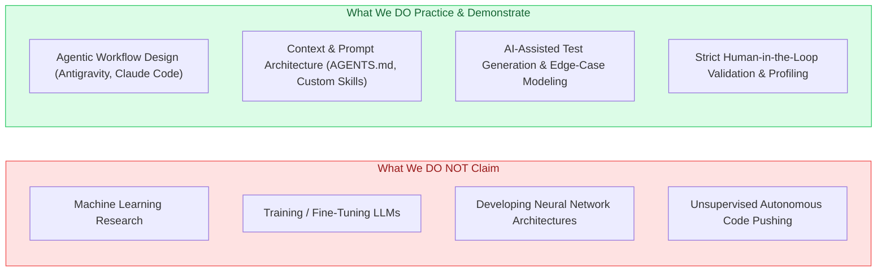

# AI-Augmented Engineering Strategy

> Portfolio Foundation — Document 04  
> Focus: Competency Matrix, Presentation Format, Workflows, Verification Protocols

---

## 1. Professional Positioning & Boundary Definition

The portfolio explicitly positions the developer’s capability as **AI-Augmented Engineering**, defined as:

> _The disciplined, systematic integration of Large Language Model (LLM) agents and developer tooling into the software engineering lifecycle to increase implementation velocity, test coverage, and documentation quality, while strictly preserving architectural integrity and runtime performance through human-in-the-loop validation._

### Critical Positioning Rules:

1. **Never claim AI/ML Engineering:** The developer is a **Senior Unity Engineer** who uses AI as an advanced power tool, not a data scientist or PyTorch researcher.
2. **Never quote fabricated metrics:** Claims such as _"10x faster"_ or _"Boosted output by 43.8%"_ destroy engineering credibility. Instead, focus on qualitative, process-verifiable outcomes: _"Rapidly scaffolded edge-case test suites covering boundary conditions and invalid state transitions"_ or _"Automated repetitive boilerplate generation for REST API serialization wrappers."_
3. **Always foreground human validation:** Emphasize that AI output is treated as untrusted draft input until verified through unit tests, compiler checks, memory profiling, and architectural review.

---

## 2. Four Core Competency Pillars

### Pillar 1: AI Development Workflows & Task Decomposition

- **Context Preparation:** Structuring the problem space into discrete, verifiable subtasks before invoking agents.
- **Iterative Prompting & Execution:** Running small, testable loops rather than asking for entire game systems in one prompt.
- **Multi-Step Pipelines:** Combining shell execution, static analysis, and code generation in automated sequences.
- **SDK Documentation Research:** Using AI agents to quickly parse external SDK documentation, migration guides, and API deprecations.

### Pillar 2: Agent & Context Architecture

- **Repository Context Engineering:** Authoring and maintaining `AGENTS.md`, `.cursorrules`, and contextual project maps that eliminate hallucinations and enforce conventions.
- **Custom Skills & Subagents:** Defining reusable subagent roles (e.g., Codebase Researcher, Profiler Auditor, Test Harness Generator) with restricted, safe toolsets.
- **Documentation Synchronization:** Keeping architectural decisions, data models, and codebases synchronized using automated agent inspection.

### Pillar 3: Engineering Quality & Automated Verification

- **Automated Test Generation:** Prompting agents to generate comprehensive edge-case tests (boundary conditions, null arguments, state transition invalidity) for pure C# logic.
- **Code Review & Static Analysis:** Using agents as a preliminary review pair of eyes to spot potential GC allocations, missing null checks, or violation of project conventions.
- **Refactoring Assistance:** Safely decomposing legacy `MonoBehaviour` monolithic classes into decoupled service objects.

### Pillar 4: Productivity & Operational Acceleration

- **Eliminating Boilerplate:** Rapid generation of DTOs, data tables, serialization adapters, and event wrappers.
- **REST API Data Modeling:** Quickly generating strongly typed C# request/response data structures from JSON schemas or API documentation.
- **Accelerated Onboarding:** Generating structured architectural walkthroughs and codebase maps for new team members.

---

## 3. Separation of Context: Professional vs. Independent

To preserve absolute integrity, the portfolio transparently labels where each workflow was applied:

| Competency Area                 | Commercial Production Environment                                                                                          | Independent / Lab Workflows                                                           |
| :------------------------------ | :------------------------------------------------------------------------------------------------------------------------- | :------------------------------------------------------------------------------------ |
| **API & SDK Research**          | Rapidly parsed third-party SDK documentation (store auth, ads, analytics) and breaking change logs to plan integration.    | Explored multi-agent API integration workflows.                                       |
| **Crash & Log Triage**          | Analyzed stack traces and log dumps from Firebase Crashlytics to isolate reproduction steps and potential null references. | Synthesized synthetic stress tests for custom systems.                                |
| **Test Scaffolding**            | Drafted unit tests for utility functions, math calculations, and serialization logic where IP policies permitted.          | Full-scale test suite generation across standalone C# algorithms and state machines.  |
| **Context Tooling (AGENTS.md)** | Introduced local developer documentation best practices to keep team standards aligned.                                    | Authored complete custom skills, task agents, and automated development instructions. |

---

## 4. Featured Case Studies for the AI Engineering Page

### Case Study A: AI-Assisted Test Harness & Edge-Case Generation

- **Problem:** Writing exhaustive tests for algorithmic logic (grid matching, line clearing, pathfinding, or status-effect stacking) is time-consuming, leading teams to test only the "happy path."
- **AI-Augmented Approach:**
  1. Extracted pure mathematical and state-machine logic into isolated C# test fixtures.
  2. Used structured agent prompts to systematically generate adversarial inputs: out-of-bound indices, simultaneous effect expirations, circular dependencies, and extreme values.
- **Human Verification:**
  - Audited every generated test assertion to prevent false positives.
  - Verified assertions against core game rules and execution order.
- **Outcome:** Rapid test coverage expansion with minimal manual boilerplate typing, catching edge-case bugs before production deployment.

### Case Study B: Context Engineering & Agent Protocols (The AGENTS.md Architecture)

- **Problem:** Generic AI assistants produce broken Unity code because they fail to understand memory constraints, GC pressure, frame budgets, and specific third-party libraries (R3, UniTask, Zenject).
- **AI-Augmented Approach:**
  - Designed hierarchical context files (`AGENTS.md`, design system guides, architecture RFCs) that instruct agents on engine constraints, required libraries, and prohibited patterns.
- **Human Verification:**
  - Monitored agent error rates before and after context constraints were added.
- **Outcome:** Reduced hallucinations and eliminated common Unity anti-patterns (e.g., `FindObjectOfType`, string-based coroutines, excessive boxing allocations) from agent-suggested code.

---

## 5. Visual Representation on the Website

To communicate high technical credibility, the `/ai-engineering` page will feature:

1. **Interactive Workflow Diagram:** Visual step-by-step flowchart showing: `Context Preparation -> Agent Draft -> Compiler / Static Analysis -> Human Review -> Test Execution -> Integration`.
2. **Side-by-Side Verification Cards:** Showing the raw AI draft alongside the human-engineered refinement (highlighting where human domain knowledge caught subtle bugs, GC spikes, or architectural flaws).
3. **Downloadable / Inspectable Context Files:** Providing developers with real examples of well-structured `AGENTS.md` rules and custom skill definitions.
