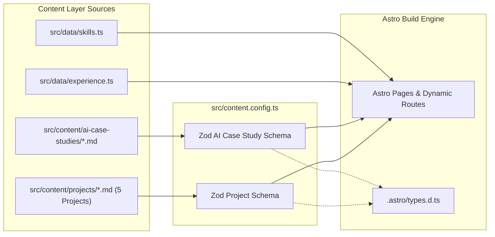

# Content Architecture & Data Model

> Portfolio Foundation — Document 03  
> Focus: Astro Content Collections, Zod Schemas, Data Structures, Extensibility

---

## 1. Architectural Choice: Astro 7 Content Layer

In **Astro 7**, structured content is managed via the **Content Layer API** in `src/content.config.ts` using `defineCollection`, `z` (Zod), and the `glob` loader.

### Key Benefits:

- **Zero Runtime Overhead:** Validated at build time (`npm run build` or `npm run check`).
- **Strict TypeScript Types:** Generates typed interfaces (`CollectionEntry<'projects'>`) in `.astro/types.d.ts`.
- **Content / Presentation Decoupling:** Markdown documents contain narrative case studies; structured frontmatter manages metadata, metrics, and badges.
- **Maintainability:** Adding projects or updating technical specs is isolated to Markdown files.



---

## 2. Directory Layout for Content

```text
src/
├── content.config.ts                # Master Content Layer schema definitions
├── content/
│   ├── projects/                    # Exactly 5 project case studies
│   │   ├── jolly-match-3.md         # Flagship commercial mobile case study
│   │   ├── ar-language-lab.md       # AR educational mobile application
│   │   ├── blue-light-epic.md       # Web3 & hardware integration project
│   │   ├── component-ability-system.md # Independent architecture showcase
│   │   └── tetris-sudocu.md         # Gameplay programming study
│   └── ai-case-studies/             # AI-Augmented Engineering case studies
│       ├── context-engineering-agents.md
│       └── ai-assisted-test-generation.md
└── data/                            # Structured TypeScript data
    ├── experience.ts                # Career timeline & company history
    ├── skills.ts                    # Categorized technology stack
    └── site-meta.ts                 # Global metadata, SEO defaults, social links
```

---

## 3. Zod Schemas (`src/content.config.ts`)

### A. Projects Collection Schema

```typescript
import { defineCollection } from 'astro:content';
import { glob } from 'astro/loaders';
import { z } from 'astro/zod';

const projectsCollection = defineCollection({
  loader: glob({ pattern: '**/*.{md,mdx}', base: './src/content/projects' }),
  schema: ({ image }) =>
    z.object({
      title: z.string().min(1),
      subtitle: z.string().min(1),
      category: z.enum([
        'commercial',
        'educational-ar',
        'hardware-web3',
        'architecture-showcase',
        'independent-game',
      ]),
      tier: z.enum(['flagship', 'core', 'compact']),
      featuredOnHome: z.boolean().default(false),
      order: z.number().default(100),

      // Project Context
      genre: z.string(),
      platforms: z.array(z.enum(['iOS', 'Android', 'PC', 'WebGL', 'Cross-platform'])),
      period: z.string().optional(),
      teamSize: z.string().optional(),
      role: z.string(), // e.g. "Senior Unity Developer"

      // Core Overview
      shortDescription: z.string().max(300),

      // Granular Responsibility Breakdown
      implementedSystems: z.array(z.string()).default([]), // Systems personally designed & implemented
      integratedSystems: z.array(z.string()).default([]), // External services/SDKs integrated
      collaborativeSystems: z.array(z.string()).default([]), // Systems built with team members

      // Specialized Technical Highlights
      technologies: z.array(z.string()).min(1),
      architectureHighlights: z.array(z.string()).default([]),
      analyticsHighlights: z.array(z.string()).default([]), // Specific to data/event tracking
      backendHighlights: z.array(z.string()).default([]), // Specific to REST/Firebase/Server

      // Visual Assets
      coverImage: z.string(),
      coverAlt: z.string(),
      gallery: z
        .array(
          z.object({
            src: z.string(),
            alt: z.string(),
            caption: z.string().optional(),
          }),
        )
        .default([]),

      // External Links
      links: z
        .array(
          z.object({
            label: z.string(),
            url: z.string().url(),
            type: z.enum([
              'googleplay',
              'appstore',
              'epicgames',
              'github',
              'youtube',
              'live',
              'article',
            ]),
          }),
        )
        .default([]),

      // Verified Production Metrics (Strictly non-invented)
      metrics: z
        .array(
          z.object({
            label: z.string(),
            value: z.string(),
            verified: z.boolean().default(true),
          }),
        )
        .default([]),
    }),
});
```

### B. AI-Augmented Engineering Case Studies Schema

```typescript
const aiCaseStudiesCollection = defineCollection({
  loader: glob({ pattern: '**/*.{md,mdx}', base: './src/content/ai-case-studies' }),
  schema: z.object({
    title: z.string().min(1),
    subtitle: z.string().min(1),
    category: z.enum([
      'workflow-automation',
      'agent-architecture',
      'test-generation',
      'code-analysis',
    ]),
    workflowType: z.enum(['professional-practice', 'independent-lab']),
    featured: z.boolean().default(false),
    order: z.number().default(100),

    problemStatement: z.string(),
    aiToolsUsed: z.array(z.string()),
    humanValidationMethod: z.string(),
    outcomes: z.array(z.string()),
    limitationsEncountered: z.array(z.string()),
  }),
});

export const collections = {
  projects: projectsCollection,
  'ai-case-studies': aiCaseStudiesCollection,
};
```

---

## 4. Structured TypeScript Data Models

### A. Experience & Career Data (`src/data/experience.ts`)

```typescript
export interface WorkExperience {
  company: string;
  role: string;
  employmentType: 'Full-time' | 'Contract' | 'Part-time';
  period: {
    start: string;
    end: string | 'Present';
  };
  location: string;
  remote: boolean;
  shortSummary: string;
  responsibilities: string[];
  leadershipAndMentoring: string[];
  technologiesUsed: string[];
  projectsLinked?: string[];
}

export const WORK_EXPERIENCE: WorkExperience[] = [
  // To be populated with verified developer chronology
];
```

### B. Skills & Tech Stack Data (`src/data/skills.ts`)

```typescript
export interface SkillCategory {
  title: string;
  description: string;
  skills: {
    name: string;
    level: 'Expert' | 'Advanced' | 'Proficient';
    highlight?: boolean;
    note?: string;
  }[];
}

export const SKILL_CATEGORIES: SkillCategory[] = [
  {
    title: 'Unity Engine & C# Core',
    description: 'Deep runtime mechanics, profiling, memory management, and language internals.',
    skills: [
      { name: 'C# (Modern Language Features, .NET / Mono)', level: 'Expert', highlight: true },
      {
        name: 'Unity Engine (Unity 6, Mobile 2D/3D Lifecycle, URP)',
        level: 'Expert',
        highlight: true,
      },
      {
        name: 'Memory & Profiler (GC Allocations, Memory Leaks, Frame spikes)',
        level: 'Expert',
        highlight: true,
      },
      { name: 'Addressables & Asset Management', level: 'Advanced' },
      { name: 'Unity UI (uGUI, UI Toolkit, Responsive Canvas)', level: 'Expert' },
    ],
  },
  {
    title: 'Backend Integration & Analytics Infrastructure',
    description: 'Connecting client games to server services, databases, and analytics pipelines.',
    skills: [
      {
        name: 'REST API Client Integration (HTTP/JSON, Auth, Error Handling)',
        level: 'Expert',
        highlight: true,
      },
      {
        name: 'Firebase (Authentication, Realtime Database, Cloud Firestore)',
        level: 'Advanced',
        highlight: true,
      },
      {
        name: 'Analytics Telemetry & Custom Events (Firebase Analytics, AppsFlyer)',
        level: 'Expert',
        highlight: true,
      },
      {
        name: 'A/B Testing & Remote Configuration (RemoteConfig, Dynamic Difficulty)',
        level: 'Advanced',
        highlight: true,
      },
      {
        name: 'Offline Data Caching & Network Synchronization',
        level: 'Advanced',
        highlight: true,
      },
    ],
  },
  {
    title: 'Software Architecture & Modular Design',
    description: 'Decoupled, maintainable architectures that scale across multi-year LiveOps.',
    skills: [
      { name: 'SOLID & Component-Based Design', level: 'Expert', highlight: true },
      { name: 'ScriptableObject-Driven Systems & Tooling', level: 'Expert', highlight: true },
      { name: 'Reactive Programming (R3, UniRx)', level: 'Advanced', highlight: true },
      { name: 'Dependency Injection (Zenject, VContainer)', level: 'Advanced', highlight: true },
      { name: 'Asynchronous Architecture (UniTask, async/await)', level: 'Advanced' },
    ],
  },
  {
    title: 'Engineering Quality, Tooling & DevOps',
    description: 'Ensuring code reliability, automated testing, and reproducible builds.',
    skills: [
      { name: 'Git & Branching Workflows (Trunk, Feature-Branch)', level: 'Expert' },
      {
        name: 'Automated Testing (AltTester, PlayMode, Unit Tests)',
        level: 'Advanced',
        highlight: true,
      },
      { name: 'Code Review Leadership & Technical Mentorship', level: 'Expert', highlight: true },
      { name: 'CI/CD Pipelines (GitHub Actions, Automated Build Scripts)', level: 'Proficient' },
    ],
  },
  {
    title: 'Specialized Technologies & AI Workflows',
    description: 'Augmented reality, external hardware, and disciplined agentic tooling.',
    skills: [
      { name: 'Augmented Reality (Vuforia, AR Foundation)', level: 'Advanced' },
      { name: 'Hardware & External Integration (NFC, Web3 APIs)', level: 'Proficient' },
      {
        name: 'Agentic Engineering (Antigravity, Claude Code, AGENTS.md)',
        level: 'Advanced',
        highlight: true,
      },
      { name: 'Human-in-the-Loop Quality Verification', level: 'Expert', highlight: true },
    ],
  },
];
```

---

## 5. Concrete Frontmatter Example: `component-ability-system.md`

```markdown
---
title: 'Component Ability System'
subtitle: 'A modular, ScriptableObject-driven gameplay ability framework with execution sequencing and status effects'
category: 'architecture-showcase'
tier: 'flagship'
featuredOnHome: true
order: 2

genre: 'Gameplay Systems Framework'
platforms: ['PC', 'Cross-platform']
role: 'Software Architect & Developer'

shortDescription: 'An independent architecture showcase demonstrating a modular ability framework in Unity. Features component-based ability composition, ScriptableObject-driven configuration, instant and over-time status effects, target selection algorithms, and clean dependency management.'

implementedSystems:
  - 'Component-based ability pipeline with pluggable execution steps'
  - 'ScriptableObject data architecture for designer-friendly configuration'
  - 'Target selection and filtering algorithms (area of effect, single-target, chain)'
  - 'Instant and over-time effect processing system with duration management'
  - 'Status effect container handling buffs, debuffs, and stackable states'

technologies:
  - 'Unity'
  - 'C#'
  - 'ScriptableObjects'
  - 'Component Architecture'
  - 'Dependency Injection'

architectureHighlights:
  - 'Abilities are composed at runtime from reusable atomic effect components'
  - 'Zero tight coupling: abilities communicate through decoupled state interfaces'
  - 'Data and execution logic strictly separated for high extensibility'

coverImage: '/images/projects/cas-cover.webp'
coverAlt: 'Component Ability System architecture and inspector setup'

links:
  - label: 'GitHub Repository'
    url: 'https://github.com/igorko8f/component-ability-system'
    type: 'github'
---

## Architectural Philosophy

The Component Ability System was built to solve the fragility of monolithic ability implementations...
[Case study narrative follows]
```
