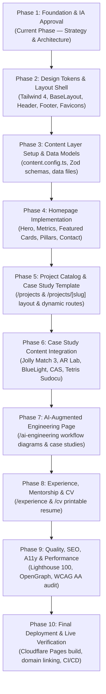

# Implementation Roadmap

> Portfolio Foundation — Document 06  
> Focus: Phased Execution Plan, Task Dependencies, Deliverables & Definition of Done

---

## 1. Roadmap Architecture & Dependency Graph

The roadmap is structured into 10 sequential phases to prevent rework, ensure technical stability, and maintain strict quality standards throughout development.

---

## 2. Phase-by-Phase Execution Plan

### Phase 1: Information Architecture, Positioning & Strategy (Current Phase)

- **Objective:** Establish rock-solid strategic clarity, content models, and visual design specifications before writing application code.
- **Tasks:**
  - Audit existing repository configuration and dependencies.
  - Define professional positioning, UVP, and tone of voice.
  - Finalize the 5-project catalog and hierarchy.
  - Formulate information architecture, sitemap, and user journeys.
  - Design Astro Content Layer schemas with strict Zod types.
  - Document AI-Augmented Engineering strategy and boundary rules.
  - Compile visual design tokens and aesthetic direction.
  - Catalogue all open questions and required developer assets in `OPEN_QUESTIONS.md`.
- **Deliverables:** Complete `ProjectDocs/Portfolio/` documentation suite.
- **Definition of Done (DoD):** All 8 planning documents reviewed and approved by the developer.

---

### Phase 2: Design Tokens, Typography & Layout Shell

- **Objective:** Build the global visual scaffolding and responsive navigation shell.
- **Dependencies:** Approval of Phase 1 (`VISUAL_DIRECTION.md`).
- **Tasks:**
  - Configure Tailwind 4 theme variables and color tokens in `src/styles/global.css`.
  - Set up font declarations (Inter + JetBrains Mono / system font fallbacks).
  - Create `src/layouts/BaseLayout.astro` with semantic `<header>`, `<main>`, `<footer>`.
  - Build `Header.astro` with desktop navigation, CTA, and accessible mobile navigation drawer.
  - Build `Footer.astro` with social links, email copy interaction, and availability badge.
  - Implement skip-to-content accessibility link.
- **Deliverables:** Reusable `BaseLayout.astro`, `Header.astro`, `Footer.astro`, responsive mobile menu.
- **Definition of Done (DoD):** Clean shell renders in browser, mobile drawer functions without framework JS, keyboard navigation works, `npm run check` and `npm run lint` pass.

---

### Phase 3: Content Layer Setup & Data Models

- **Objective:** Set up typed content infrastructure for projects and career records.
- **Dependencies:** Phase 2 complete; `CONTENT_MODEL.md` approved.
- **Tasks:**
  - Create `src/content.config.ts` with Zod validation for `projects` and `ai-case-studies`.
  - Create `src/data/experience.ts` with structured career data.
  - Create `src/data/skills.ts` with categorized technical competencies.
  - Create `src/data/site-meta.ts` for global site configuration.
  - Run Astro typegen to verify `.astro/types.d.ts` generation.
- **Deliverables:** Functional Content Layer schemas and validated data fixtures.
- **Definition of Done (DoD):** `npm run check` passes with zero type errors against schemas; content loading helper functions implemented.

---

### Phase 4: Homepage Implementation

- **Objective:** Construct the high-converting homepage (`/`) for 30-second recruiter scans and technical exploration.
- **Dependencies:** Phase 2 & 3 complete.
- **Tasks:**
  - Implement `Hero.astro` with seniority title, UVP, status badge, and primary CTAs.
  - Implement `MetricsStrip.astro` (years of experience, commercial titles, backend/analytics, AI engineering).
  - Implement `FeaturedProjects.astro` displaying flagship case study cards (_Jolly Match 3_, _Component Ability System_, _AR Language Lab_).
  - Implement `EngineeringPillars.astro` detailing client architecture, backend/analytics, and code quality.
  - Implement `AISpotlight.astro` introducing practical AI-augmented engineering workflows.
  - Implement `ContactSection.astro` with direct email copy-to-clipboard and social links.
- **Deliverables:** Fully responsive, styled homepage at `src/pages/index.astro`.
- **Definition of Done (DoD):** Homepage fully responsive from 320px to 1920px; zero layout shift; passing all linter and type checks.

---

### Phase 5: Project Catalog & Case Study Template

- **Objective:** Build the project catalog page and dynamic project case study layout.
- **Dependencies:** Phase 4 complete.
- **Tasks:**
  - Create `src/pages/projects/index.astro` displaying all 5 projects with category filters.
  - Create `ProjectCard.astro` component supporting Tier 1, Tier 2, and Tier 3 visual density.
  - Create `src/pages/projects/[slug].astro` dynamic route with `getStaticPaths()`.
  - Build `ProjectLayout.astro` featuring metadata header, role badge, architecture diagram container, challenge/solution blocks, and gallery.
  - Build `ProjectNavigation.astro` for previous/next project traversal.
- **Deliverables:** `/projects` catalog and dynamic `/projects/[slug]` route engine.
- **Definition of Done (DoD):** Dynamic routes build statically without errors; 404 handled gracefully.

---

### Phase 6: Case Study Content Integration

- **Objective:** Author and integrate comprehensive technical case studies for all 5 selected projects.
- **Dependencies:** Phase 5 complete; developer inputs from `OPEN_QUESTIONS.md`.
- **Tasks:**
  - Author `jolly-match-3.md` (Commercial gameplay, Match-3 logic, Firebase RTDB/Firestore, REST APIs, analytics infrastructure, LiveOps, monetization).
  - Author `ar-language-lab.md` (Marker-based AR, Vuforia, Unity 6, content-driven lesson decoupling).
  - Author `blue-light-epic.md` (Epic Games Store listing, NFC hardware interaction, Web3 API integration).
  - Author `component-ability-system.md` (ScriptableObject architecture, component composition, status effects).
  - Author `tetris-sudocu.md` (Block puzzle logic, Zenject DI, R3 reactive programming, custom inspector tools).
  - Optimize and place all screenshots and architecture SVGs into `public/images/`.
- **Deliverables:** 5 complete, verified Markdown case studies with assets.
- **Definition of Done (DoD):** All project pages render with high-resolution visuals, valid technical diagrams, and verified metrics.

---

### Phase 7: AI-Augmented Engineering Page

- **Objective:** Deliver the dedicated `/ai-engineering` hub demonstrating practical AI workflow leadership.
- **Dependencies:** Phase 6 complete; `AI_AUGMENTED_ENGINEERING.md` guidelines.
- **Tasks:**
  - Create `src/pages/ai-engineering/index.astro`.
  - Build interactive/visual `WorkflowDiagram.astro` showing the human-in-the-loop lifecycle.
  - Author AI case studies (`context-engineering-agents.md`, `ai-assisted-test-generation.md`).
  - Integrate comparison snippets: AI draft vs human-reviewed production code.
- **Deliverables:** `/ai-engineering` page and dedicated case study components.
- **Definition of Done (DoD):** Clear distinction between commercial and lab work maintained; zero unsupported claims; rigorous engineering tone.

---

### Phase 8: Experience, Mentorship & Resume Page

- **Objective:** Provide deep career timeline, leadership proof, and printable CV.
- **Dependencies:** Phase 3 complete; verified chronology.
- **Tasks:**
  - Create `src/pages/experience/index.astro` with interactive chronological timeline.
  - Build `ExperienceCard.astro` highlighting leadership, mentoring, and technical ownership.
  - Create `src/pages/cv/index.astro` with print-optimized CSS (`@media print`).
  - Add downloadable PDF resume to `public/documents/`.
- **Deliverables:** `/experience` timeline and printable `/cv` page.
- **Definition of Done (DoD):** Print stylesheet generates a clean 1-2 page PDF resume; career chronology validated.

---

### Phase 9: Quality, SEO, Accessibility & Performance

- **Objective:** Maximize lighthouse scores, search engine visibility, and accessibility compliance.
- **Dependencies:** All pages built.
- **Tasks:**
  - Configure OpenGraph images, Twitter cards, and JSON-LD schema (Person / CreativeWork).
  - Create automated `sitemap-index.xml` and `robots.txt`.
  - Conduct full accessibility audit: ARIA labels, color contrast check, keyboard navigation, focus visible rings.
  - Image optimization audit: WebP format, responsive sizes, lazy loading for below-the-fold assets.
  - Verify zero unnecessary client-side JavaScript execution.
- **Deliverables:** Production-grade SEO metadata, accessibility guarantees, and performance audit.
- **Definition of Done (DoD):** Lighthouse score 95+ across Performance, Accessibility, Best Practices, and SEO; passes `npm run check`, `npm run lint`, `npm run format:check`.

---

### Phase 10: Final Deployment & Live Verification

- **Objective:** Deploy static site to Cloudflare Pages and verify live production behavior.
- **Dependencies:** Phase 9 complete; Cloudflare credentials.
- **Tasks:**
  - Test production build locally with `npm run build` and `npm run preview`.
  - Verify GitHub Actions CI workflow runs green on `main`.
  - Connect repository to Cloudflare Pages (build command: `npm run build`, output directory: `dist`).
  - Validate custom domain, SSL certificates, security headers, and redirect rules.
  - Test contact links and resume download on live production URL.
- **Deliverables:** Live, publicly accessible portfolio website.
- **Definition of Done (DoD):** Site live on Cloudflare Pages, SSL active, all links verified, CI build passing.
