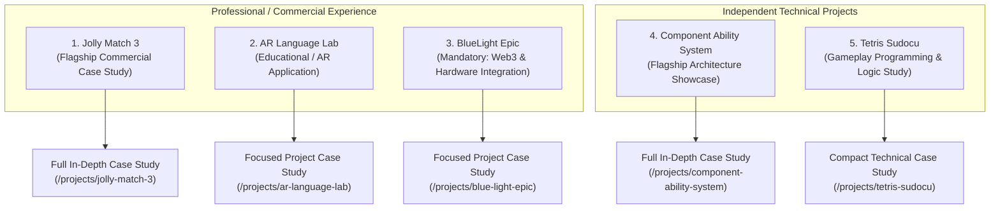
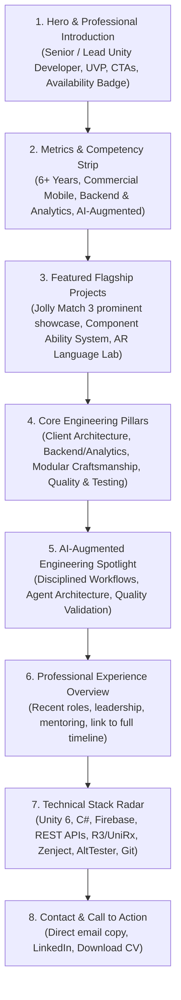
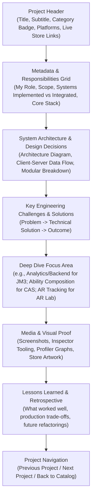
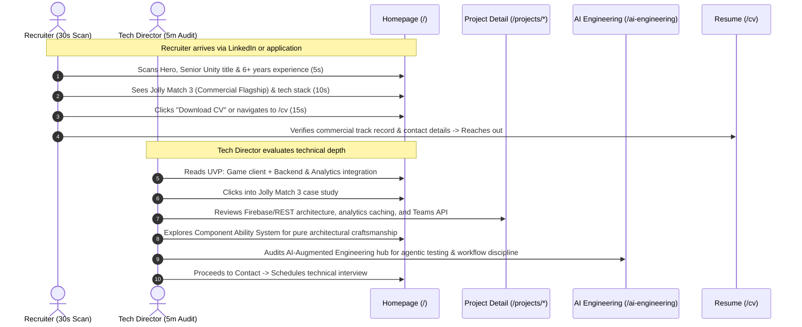

# Information Architecture & UX Strategy

> Portfolio Foundation — Document 02  
> Focus: Sitemap, Navigation, Page Hierarchy, Project Strategy, User Journeys

---

## 1. Project Catalog Strategy & Tiering

The portfolio features exactly five carefully chosen projects. Rather than treating all projects identically, we establish a purposeful hierarchy that balances commercial production experience with deep architectural craftsmanship.



### Strategic Evaluation of the 5 Projects:

| Project                      | Category / Context                 | Depth Tier            | Homepage Presence               | Strategic Role in Portfolio                                                                                                                                                                                                                                                        |
| :--------------------------- | :--------------------------------- | :-------------------- | :------------------------------ | :--------------------------------------------------------------------------------------------------------------------------------------------------------------------------------------------------------------------------------------------------------------------------------- |
| **Jolly Match 3**            | Commercial Mobile Title            | **Tier 1 (Flagship)** | Primary Spotlight (Hero Card)   | Demonstrates full commercial mastery: Match-3 gameplay systems, **analytics infrastructure (custom events, user properties, offline cache)**, **backend integration (Firebase Auth/RTDB/Firestore, REST APIs for Teams/Chat)**, A/B testing, monetization, LiveOps, and mentoring. |
| **Component Ability System** | Independent Technical Project      | **Tier 1 (Flagship)** | Featured Architecture Card      | Demonstrates software engineering craftsmanship: modular component-based ability architecture, ScriptableObject composition, execution sequencing, instant & over-time status effects, dependency injection, and clean separation of concerns.                                     |
| **AR Language Lab**          | Educational Application            | **Tier 2 (Core)**     | Featured Domain Card            | Demonstrates specialized technology and cross-platform mobile engineering: Unity 6, Vuforia marker-based AR, interactive vocabulary tasks, and a content-driven architecture where lessons are decoupled from application updates.                                                 |
| **BlueLight Epic**           | Commercial / Store Release         | **Tier 2 (Core)**     | Secondary Grid Card             | Demonstrates external technology integration in a production game: listed on Epic Games Store, featuring NFC hardware interactions and Web3/blockchain ecosystem integration. Presented with technical rigor.                                                                      |
| **Tetris Sudocu**            | Technical Assignment / Independent | **Tier 3 (Compact)**  | Projects Catalog & Compact Card | Demonstrates solid gameplay programming and modern tech stack: Unity 6, Zenject DI, R3 reactive event streams, DOTween animations, and custom Unity Inspector tools for 5x5 figure matrix creation.                                                                                |

---

## 2. Complete Sitemap & URL Structure

```text
/
├── projects/
│   ├── index.html                           (/projects) -> Full filterable project catalog
│   ├── jolly-match-3/index.html              (/projects/jolly-match-3) -> Flagship commercial case study
│   ├── ar-language-lab/index.html            (/projects/ar-language-lab) -> AR educational case study
│   ├── blue-light-epic/index.html            (/projects/blue-light-epic) -> Hardware & Web3 case study
│   ├── component-ability-system/index.html   (/projects/component-ability-system) -> Architecture case study
│   └── tetris-sudocu/index.html              (/projects/tetris-sudocu) -> Gameplay engineering case study
├── ai-engineering/index.html                (/ai-engineering) -> Dedicated AI-Augmented Engineering hub
├── experience/index.html                    (/experience) -> Career timeline, leadership, mentoring & CV
├── cv/index.html                            (/cv) -> Web-viewable & printable resume (+ PDF download)
└── 404.html                                 (Custom 404 with navigation back to safety)
```

---

## 3. Navigation Architecture

### Primary Desktop Navigation (Header)

Sticky top bar with backdrop blur:

- **Left:** Developer Brand / Logo (`[Name] / Senior Unity Developer`)
- **Right:**
  - `Projects` (links to `/projects`, active on all `/projects/*`)
  - `AI Engineering` (links to `/ai-engineering`)
  - `Experience` (links to `/experience`)
  - `Resume / CV` (links to `/cv`)
  - `Contact` (primary CTA button: triggers mailto / contact anchor)

### Mobile Navigation

- Minimal header with logo and accessible hamburger button.
- Full-screen slide-over drawer with high-contrast touch targets.
- Direct contact links (Email, Telegram, LinkedIn) pinned to the drawer bottom.

### Global Footer

Present on all pages:

- Direct email contact with copy-to-clipboard functionality.
- Social links: GitHub, LinkedIn, Telegram.
- Availability status: `🟢 Available for Senior / Lead Roles (Remote / Relocation)`.

---

## 4. Homepage Hierarchy & Sections (`/`)

The homepage is designed to deliver immediate credibility within 15–30 seconds while giving engineering decision-makers direct pathways to in-depth case studies.



### Detailed Homepage Breakdown:

1. **Hero Section:**
   - Pre-title: `SENIOR / LEAD UNITY DEVELOPER`
   - Headline: _Building scalable Unity game architectures, connected live systems & AI-augmented workflows._
   - Subtitle: 6+ years specializing in commercial mobile games, REST/Firebase backend integration, analytics pipelines, and modular gameplay systems.
   - Primary CTAs: `[Explore Projects]` and `[Download CV]`.
2. **Metrics & Impact Strip:**
   - `6+` Years Professional Game Development
   - `Commercial Mobile` LiveOps & Shipped Titles
   - `Full-Product` Backend Integration & Analytics Pipelines
   - `AI-Augmented` Agentic Engineering & Workflow Automation
3. **Featured Projects (The Showcase):**
   - **Spotlight Card (Jolly Match 3):** Full-width or large featured card. Highlighting commercial client architecture, gameplay features, **Firebase/REST backend integration (Teams, Chat, Cloud Firestore)**, and **Analytics infrastructure (68KB analytics manager, custom event tracking, offline caching)**.
   - **Card 2 (Component Ability System):** Flagship architecture card highlighting ScriptableObject composition, modular abilities, and dependency injection.
   - **Card 3 (AR Language Lab):** Specialized mobile AR card highlighting Unity 6, Vuforia, and content-driven lesson decoupling.
   - _Link to full catalog:_ `[View All 5 Projects ->]`
4. **Core Technical Pillars:**
   - _Commercial Gameplay & Client Architecture_ (Match-3 mechanics, puzzle logic, mobile optimization)
   - _Backend Integration & Analytics Pipelines_ (REST APIs, Firebase RTDB/Firestore, telemetry, A/B testing)
   - _Modular Architecture & Design Patterns_ (Component-based design, ScriptableObjects, Zenject DI, R3 reactive)
   - _Engineering Quality & Production Tooling_ (AltTester, PlayMode tests, CI/CD, code review mentorship)
5. **AI-Augmented Engineering Teaser:**
   - Highlights disciplined use of AI agents for task decomposition, context engineering, and test harness generation.
   - Link: `[Explore AI Workflows & Case Studies ->]`
6. **Experience Snapshot:**
   - Chronological summary of commercial roles and leadership responsibilities.
7. **Contact / CTA Section:**
   - One-click email copy, LinkedIn, and resume download.

---

## 5. Project Detail Template (`/projects/[slug]`)

Every project page follows an engineering-first structure:



---

## 6. User Journeys


