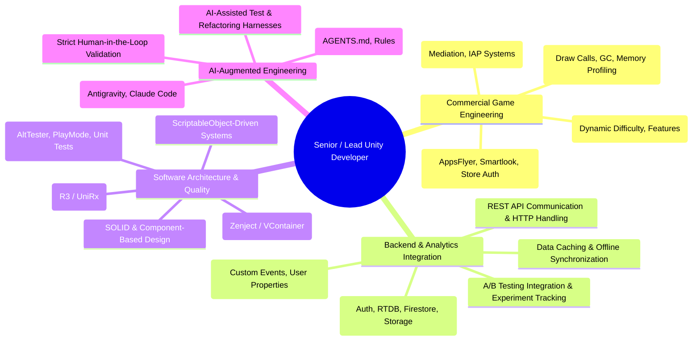

# Professional Positioning & Strategy

> Portfolio Foundation — Document 01  
> Focus: Developer Identity, Target Audience, Value Proposition, Core Pillars

---

## 1. Professional Identity

The portfolio represents a **Senior / Lead Unity Developer** with **6+ years of commercial game development experience**.

The developer's identity is firmly anchored in **game engineering**, strengthened by deep experience with **backend integration, analytics infrastructure, and modern AI-augmented workflows**:

1. **Commercial Mobile Game Development:** Proven track record of architecting, shipping, and maintaining commercial mobile titles with complex gameplay loops, meta-features, and smooth performance.
2. **Backend Integration & Analytics Infrastructure:** Deep understanding of the game client as part of a complete live product—REST API communication, Firebase & Google Cloud Platform services, client-server data synchronization, robust analytics pipelines, and A/B testing experiment integration.
3. **Software Architecture & Engineering Quality:** Modular, decoupled architecture, ScriptableObject-driven systems, reactive programming (R3 / UniRx), dependency injection (Zenject / VContainer), automated testing, and CI/CD pipelines.
4. **AI-Augmented Engineering:** Practical, disciplined integration of LLMs and agentic workflows (Antigravity, Claude Code, GitHub Copilot) to accelerate task decomposition, test generation, and refactoring while preserving strict human-in-the-loop quality.

> **Positioning Boundary:** The developer is a **Unity Game Developer**, not a generic backend engineer or web developer. Backend integration, REST APIs, and analytics pipelines are presented as critical engineering competencies that make the developer an exceptional game client architect who understands full-lifecycle live operations.

### Tagline & Value Statements

- **Primary Tagline:**  
  _Senior / Lead Unity Developer — Building High-Performance Game Architectures, Connected Live Systems & AI-Augmented Pipelines._
- **Short Sub-tagline (Hero):**  
  _6+ years building commercial mobile titles, scalable gameplay systems, analytics pipelines, and modern engineering workflows._
- **Elevator Pitch (30 Seconds):**  
  _I specialize in architecting maintainable, high-performance Unity games and connecting them to live backend and analytics systems. From core gameplay mechanics and modular ability architectures to Firebase/REST integrations, automated testing, and AI-augmented workflows, I help game studios build, operate, and scale successful titles._

---

## 2. Target Audience Segmentation

The portfolio is architected for two distinct reading patterns:

- **Fast Evaluation (15–30 seconds):** Technical recruiters and hiring coordinators confirming seniority, years of experience, commercial mobile track record, core tech stack, and verifiable shipped titles.
- **Deep Technical Audit (3–10 minutes):** CTOs, Technical Directors, and Lead Engineers looking for architectural decisions, client-server integration boundaries, data pipelines, code quality, and technical leadership.

| Audience Segment                     | Primary Concerns & Questions                                                                                                       | What We Must Show Them                                                                                                                         | Key Sections                                                                              |
| :----------------------------------- | :--------------------------------------------------------------------------------------------------------------------------------- | :--------------------------------------------------------------------------------------------------------------------------------------------- | :---------------------------------------------------------------------------------------- |
| **Technical Recruiters**             | _Is this developer senior? Have they shipped commercial Unity titles? Can they handle our mobile stack?_                           | 6+ year timeline, commercial flagship (_Jolly Match 3_), explicit technologies (C#, Unity, Mobile iOS/Android, Firebase, REST, CI/CD).         | Hero, Stats strip, Featured Projects, Skills summary, Downloadable CV.                    |
| **CTOs & Technical Directors**       | _Can this person architect systems that survive LiveOps? Do they understand client-server boundaries, analytics, and performance?_ | Architectural decisions, REST API & Firebase integration, analytics pipeline design, memory profiling, and modular decoupling.                 | _Jolly Match 3_ case study, _Component Ability System_ case study, Architecture diagrams. |
| **Lead Engineers & Hiring Managers** | _Would I enjoy reviewing their PRs? Do they understand Unity memory, GC allocations, and clean patterns?_                          | Concrete engineering challenges, ScriptableObject architectures, reactive programming (R3/UniRx), automated tests, and code quality practices. | Project Case Studies, Code Snippets, Experience timeline.                                 |
| **Indie Studios & Scale-ups**        | _Can this developer take ownership of game client systems, connect to backends, and accelerate our team?_                          | End-to-end feature ownership, autonomy, AR/specialized technology integration (_AR Language Lab_, _BlueLight Epic_), AI-assisted velocity.     | Full Project Catalog, AI Engineering hub, Direct Contact CTA.                             |

---

## 3. Unique Value Proposition (UVP)

$$\text{Commercial Mobile LiveOps} + \text{Connected Client-Server Architecture} + \text{Modular Craftsmanship} + \text{AI Velocity}$$

1. **Full-Product Game Engineering:** Understands that modern games do not run in an isolated client bubble. Proficient in integrating client gameplay with authentication, live databases, REST APIs, remote configs, and analytics events.
2. **Production-Hardened Mobile Experience:** Battle-tested with memory limits, battery consumption, GC spikes, third-party monetization SDKs, and live-event deadlines.
3. **Architectural Decoupling:** Employs component-based designs, ScriptableObjects, reactive data binding, and dependency injection to keep codebases testable and extensible.
4. **Disciplined AI Engineering:** Leverages AI agents for task decomposition, context engineering, and test harness generation without sacrificing code review rigor or safety.

---

## 4. Core Competency Pillars

---

## 5. Tone of Voice & Content Principles

### Principle 1: Show Engineering Depth, Not Just Surface Mechanics

- **Do not say:** _"I integrated Firebase into a mobile game."_
- **Do say:** _"Architected a resilient Firebase integration layer supporting Realtime Database and REST APIs for team chat and social features. Implemented client-side input validation, JWT token handling, and offline payload caching to ensure zero data loss during network dropouts."_

### Principle 2: Truthful Attribution & Responsibility Boundaries

- Explicitly distinguish between:
  - **Personally Designed & Implemented:** Systems created from the ground up (e.g., modular ability architecture, custom Inspector tools, analytics event wrappers).
  - **Integrated & Maintained:** External services and SDKs integrated into Unity (e.g., Firebase Auth, Google Mobile Ads, AppsFlyer, NFC hardware bridges).
  - **Collaborative Systems:** Work delivered in coordination with backend developers, game designers, and QA engineers.
- Never claim backend server infrastructure development if the actual role was client-side API integration and data mapping.

### Principle 3: Pragmatism over Dogmatism

- Highlight architectural trade-offs: when to use strict dependency injection (Zenject) vs. lightweight ScriptableObject workflows, and how to manage garbage collection overhead in performance-critical loops.

### Principle 4: Boundary Rules for AI-Augmented Engineering

- Position AI as an engineering multiplier for context modeling, task decomposition, and test generation.
- **Never claim** AI/ML research or model training.
- Emphasize human-in-the-loop validation: all AI-suggested code is audited against Unity engine performance, memory allocation rules, and architectural guidelines.
