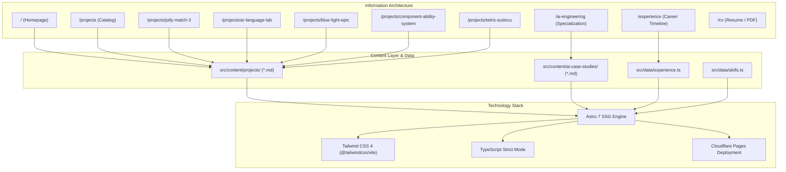

# Unity Game Developer Portfolio — Foundation & Architecture

> Phase 1.2: Information Architecture, Positioning & Content Strategy  
> Status: Planning Complete — Awaiting Final Review & Approval

---

## 1. Executive Summary

This documentation suite establishes the strategic, structural, content, and technical foundation for the portfolio of a **Senior / Lead Unity Developer** with **6+ years of professional game development experience**.

The primary objective of the portfolio is to position the developer as a high-impact engineering leader who combines:

1. **Commercial Mobile Game Engineering:** Proven experience shipping, maintaining, and scaling mobile titles (gameplay systems, LiveOps, monetization, performance profiling).
2. **Backend Integration & Analytics Infrastructure:** End-to-end understanding of how a commercial game functions as a complete product—client-server REST API communication, Firebase / GCP services, custom analytics event tracking, and data-driven A/B testing.
3. **Software Craftsmanship & Systems Architecture:** Mastery of decoupled, testable systems (component-based design, ScriptableObject architectures, reactive programming with R3/UniRx, dependency injection with Zenject/VContainer, and automated testing).
4. **AI-Augmented Engineering:** Practical, disciplined integration of AI models and agentic workflows (Antigravity, Claude Code, GitHub Copilot) into the engineering lifecycle to accelerate delivery while maintaining strict human-in-the-loop quality standards.

The site is built with **Astro 7**, **Tailwind CSS 4**, and **strict TypeScript**, compiled to a zero-JS-by-default static site deployed on **Cloudflare Pages**.

---

## 2. Selected Project Catalog (The 5 Core Projects)

The portfolio features exactly five projects organized into two distinct tiers:

### Professional & Commercial Experience

1. **Jolly Match 3 (Main Professional Case Study):** Flagship commercial mobile title showcasing client architecture, gameplay systems, comprehensive analytics event tracking, Firebase & GCP backend integration, REST APIs, LiveOps, monetization, and team mentoring.
2. **AR Language Lab:** Marker-based Augmented Reality educational application built with Unity and Vuforia, featuring a content-driven decoupled architecture for multilingual vocabulary learning.
3. **BlueLight Epic (Mandatory Project):** Commercial title listed on the Epic Games Store demonstrating external technology integration in Unity, including NFC hardware interaction and Web3/blockchain functionality.

### Independent Technical Projects

4. **Component Ability System:** Independent architectural showcase demonstrating a modular, component-based gameplay ability framework driven by ScriptableObjects, composition, and dependency injection.
5. **Tetris Sudocu:** Gameplay programming study combining Block Puzzle and Sudoku mechanics, built with Unity 6, Zenject (DI), R3 (reactive programming), and custom Unity Inspector tooling.

---

## 3. Documentation Index

The foundation is organized into eight specialized documents under `ProjectDocs/Portfolio/`:

| Document                                                         | Purpose & Scope                                                                                                                      | Target Audience                       |
| :--------------------------------------------------------------- | :----------------------------------------------------------------------------------------------------------------------------------- | :------------------------------------ |
| [**POSITIONING.md**](./POSITIONING.md)                           | Professional identity, target audience segments, UVP, core pillars, and messaging principles.                                        | Recruiter / Hiring Manager / Strategy |
| [**INFORMATION_ARCHITECTURE.md**](./INFORMATION_ARCHITECTURE.md) | Complete sitemap, routing structure, navigation systems, homepage layout, project templates, and user journeys.                      | UX Architect / Developer              |
| [**CONTENT_MODEL.md**](./CONTENT_MODEL.md)                       | Astro Content Collections schemas, Zod validation models, project metadata definitions, and data structures.                         | Technical Architect / Content Editor  |
| [**AI_AUGMENTED_ENGINEERING.md**](./AI_AUGMENTED_ENGINEERING.md) | Strategy for positioning AI-assisted engineering workflows, competency breakdown, case studies, and boundary rules.                  | Technical Directors / Hiring Leads    |
| [**VISUAL_DIRECTION.md**](./VISUAL_DIRECTION.md)                 | Design directions analysis, typography, color palette, component design tokens, asset strategy, and motion principles.               | Product Designer / Frontend Dev       |
| [**IMPLEMENTATION_ROADMAP.md**](./IMPLEMENTATION_ROADMAP.md)     | 10-phase sequential execution roadmap, task breakdown, dependencies, deliverables, and Definition of Done.                           | Project Lead / Developer              |
| [**OPEN_QUESTIONS.md**](./OPEN_QUESTIONS.md)                     | Catalog of unconfirmed metrics, missing project assets, technical clarifications, and strategic decisions needed from the developer. | Developer / Stakeholder               |

---

## 4. High-Level Architecture Overview

---

## 5. Current Planning Status & Next Steps

- [x] **Repository Analysis:** Audit of existing build, styling, scripts, dependencies, and configuration.
- [x] **Positioning & Messaging Strategy:** Updated to emphasize Unity core, analytics infrastructure, backend communication, and AI engineering.
- [x] **Information Architecture & UX Flows:** Restructured around the 5 selected projects with Jolly Match 3 as the primary flagship.
- [x] **Content Model & Schemas:** Designed Astro Content Layer schemas with strict Zod validation.
- [x] **AI-Augmented Engineering Strategy:** Practical workflows and context engineering separated from speculative claims.
- [x] **Visual Direction Definition:** Selected modern dark-mode game engineering visual language.
- [x] **Implementation Roadmap:** Updated 10-phase milestone schedule.
- [x] **Open Questions Catalog:** Comprehensive audit of missing details across all 5 projects.
- [ ] **Developer Review & Sign-Off:** Review phase deliverables before proceeding to Phase 2 (Design System & Shell).
