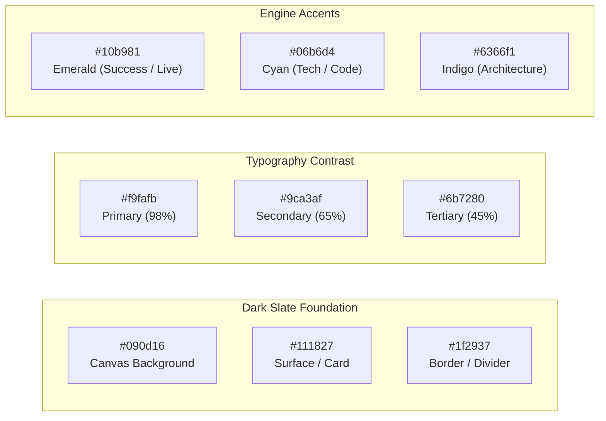
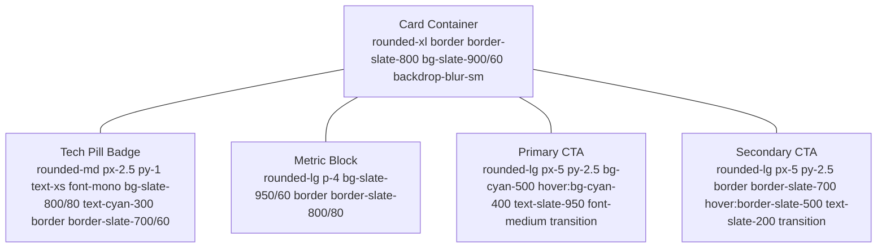

# Visual Direction & Design System Strategy

> Portfolio Foundation — Document 05  
> Focus: Aesthetic Directions, Color System, Typography, Layout, Motion & Tokens

---

## 1. Evaluation of Visual Directions

To establish the optimal visual balance for a Senior / Lead Unity Engineer, we evaluated three distinct directions:

| Attribute          | Direction A: Minimal Engineering                                                          | Direction B: Modern Game Engineering                                                                                                            | Direction C: Editorial Technical Case Study                                                              |
| :----------------- | :---------------------------------------------------------------------------------------- | :---------------------------------------------------------------------------------------------------------------------------------------------- | :------------------------------------------------------------------------------------------------------- |
| **Aesthetic Mood** | Stark, monochrome, terminal-inspired, Swiss typography.                                   | Dark modern engine UI (similar to Unity Editor / Unreal / Linear), sleek contrast, subtle glow accents.                                         | Medium / Substack / Stripe Docs style, white/off-white paper aesthetic, dense long-form prose.           |
| **Strengths**      | Immediate technical credibility; loads fast; zero distraction.                            | Evokes game development tooling; showcases visual game assets without losing professional sobriety; engaging for both recruiters and engineers. | Excellent for deep architectural case studies and long code breakdowns.                                  |
| **Weaknesses**     | Can feel cold, generic, or like a web backend engineer with zero visual game sensibility. | Requires careful restraint to avoid looking like a gaming clan page or gamer hardware brand.                                                    | Often feels too academic; screenshots and gameplay graphics look disconnected against stark white paper. |
| **Verdict**        | _Too dry for a game developer._                                                           | **Recommended (Primary Foundation)**                                                                                                            | **Recommended (Content & Diagram Style)**                                                                |

### Recommended Synthesis: "Modern Game Engineering with Editorial Rigor"

We blend the polished, focused dark aesthetic of **Direction B** (reminiscent of professional game development tools like Rider, Unity dark theme, and Linear) with the structured technical clarity and diagrammatic depth of **Direction C**.

---

## 2. Color Palette & Theming (Tailwind CSS 4)

The palette uses a deep neutral foundation with high-contrast text and a purposeful accent color inspired by game engine compilation and debugging indicators.

### Color Token Definitions:

- **Background Deep (`bg-slate-950` / `#0a0f1d`):** Deep slate-navy base, avoids harsh pure `#000000` to prevent eye fatigue.
- **Card Surface (`bg-slate-900/80` / `#111827`):** Elevated cards with subtle 1px border (`border-slate-800`).
- **Surface Hover (`hover:border-slate-700`):** Crisp hover states that reward interactivity without flashy animations.
- **Primary Text (`text-slate-100` / `#f8fafc`):** 16.5:1 contrast against background (exceeds WCAG AAA).
- **Muted Text (`text-slate-400` / `#94a3b8`):** Clean readability for secondary descriptions and metadata.
- **Accent Emerald (`#10b981`):** Represents live commercial status, passed tests, and active availability.
- **Accent Cyan (`#06b6d4`):** Represents technical architecture, pure C# code snippets, and active pills.
- **Accent Amber (`#f59e0b`):** Highlights production challenges, profiling alerts, and metrics.

---

## 3. Typography Strategy

We pair an ultra-clean modern geometric sans-serif for UI, headings, and readability with a precision monospace font for technical specifications, code, and metadata.

### 1. Primary Sans Font (UI & Body)

- **Selection:** `Inter`, system fallback: `-apple-system, BlinkMacSystemFont, 'Segoe UI', Roboto, sans-serif`
- **Application:** Page titles, body prose, navigation, case study narratives.
- **Characteristics:** High x-height, open apertures, flawless legibility at 14px–18px.

### 2. Technical Monospace Font (Code & Data)

- **Selection:** `JetBrains Mono` or `ui-monospace, 'SF Mono', Consolas, monospace`
- **Application:** Technology badges, metric labels, code snippets, architecture labels, file paths.
- **Characteristics:** Clear distinction between `0` and `O`, `1` and `l`, evoking Unity / Rider code editor familiarity.

### Typographic Scale:

- **Hero Title (`h1`):** `text-4xl sm:text-5xl lg:text-6xl font-bold tracking-tight`
- **Section Heading (`h2`):** `text-2xl sm:text-3xl font-semibold tracking-tight`
- **Card Heading (`h3`):** `text-lg sm:text-xl font-medium`
- **Body Text:** `text-base sm:text-lg leading-relaxed text-slate-300`
- **Meta / Eyebrow:** `text-xs uppercase font-mono tracking-wider text-cyan-400`

---

## 4. Layout & Spacing Principles

- **Fluid Grid Container:** Max-width of `max-w-6xl` (1152px) for comfortable reading, centered with responsive horizontal padding (`px-4 sm:px-6 lg:px-8`).
- **Consistent Vertical Cadence:** 80px to 120px between major homepage sections (`py-20 lg:py-28`) to create breathing room.
- **Visual Rhythm:** Alternating between compact dense metadata strips and spacious narrative case study cards.
- **Responsive-First:** 1-column mobile layouts transitioning smoothly into 2-column and 3-column grids on desktop (`grid-cols-1 md:grid-cols-2 lg:grid-cols-3`).

---

## 5. Component Design Tokens

### Component Details:

1. **Case Study Cards:**
   - Dark translucent slate background with 1px border.
   - Subtle top gradient border on hover.
   - High-contrast visual thumbnail / architecture preview with rounded inner corners.
2. **Architecture Diagrams:**
   - Rendered using Mermaid with clean SVG styling or custom interactive SVG components.
   - Dark background matching surface cards with crisp colored nodes (Domain = Blue, Presentation = Green, Infrastructure = Purple).
3. **Status Indicator:**
   - Pulsing green dot: `🟢 Available for Senior / Lead Roles`

---

## 6. Motion & Interactive Polish

### Principles:

- **Subtle, not Distracting:** Micro-interactions (hover transitions, border light-ups) run under 200ms (`duration-200 ease-out`).
- **No Heavy Physics / Canvas Bloat:** Avoid 3D WebGL canvases or heavy particle engines on the homepage that drain battery and slow down mobile recruiters.
- **Respect Accessibility:** Full support for `prefers-reduced-motion: reduce`. All transitions collapse to instantaneous opacity switches when enabled.

---

## 7. Media & Visual Asset Strategy

1. **Images:**
   - Stored in modern `.webp` or `.avif` formats.
   - Processed via Astro’s built-in image optimization (`astro:assets`).
   - Explicit `width` and `height` attributes to prevent Cumulative Layout Shift (CLS).
2. **Screenshots & Captures:**
   - High-DPI mockups framed with minimal browser / mobile chrome borders.
   - Focus on gameplay clarity and UI polish.
3. **Diagrams:**
   - Vector SVGs and Markdown Mermaid flowcharts instead of fuzzy raster screenshots of diagrams.
